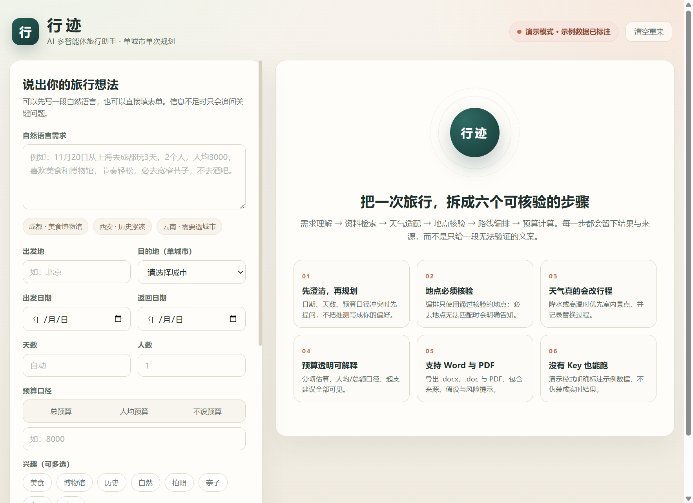
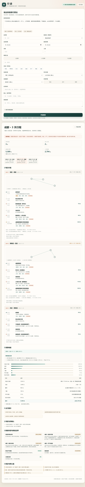
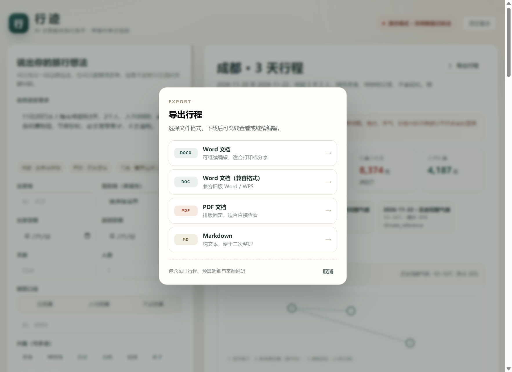

# 行迹 · AI 多智能体旅行助手

面向中文用户的单城市旅行规划产品：用表单或一段自然语言描述需求，经过 **需求理解 → 资料检索 → 天气适配 → 地点核验 → 路线编排 → 预算计算** 六个 Agent 的显式流水线，输出带来源、假设与风险提示的可执行行程，并支持 `.doc`、`.docx`、`.pdf`、`.md` 导出。

当前运行在**演示模式**（未配置任何真实 Key）：地点、天气、价格均来自示例数据或规则估算，页面与导出文件都会标注来源，不伪装成实时查询结果。

---

## 页面预览

**首页：自然语言 + 表单双输入，信息不足时才追问**



**行程结果：天气、预算、每日时间轴、路线草图与每个地点的核验等级**



**导出行程：一个按钮，弹窗内选择 Word / PDF / Markdown**



> 截图中的数据来自演示模式；示例地点带「必去」标签时，表示该地点来自用户输入。

---

## 1. 产品能力

### 需求输入

- 表单与自然语言均可，字段覆盖出发地、目的地、日期、天数、人数、总预算或人均预算、兴趣、往返交通、市内交通、住宿偏好、节奏、必去地点、禁止事项、其他说明。
- 自然语言解析日期、天数、人数（`4人` / `4个人` / `两人`）、预算与口径、兴趣、必去、避开、节奏、出发地。
- 信息不足时每轮最多提 3 个关键问题；日期倒挂、日期与天数不一致、预算口径不明时先澄清，不擅自改用户输入。
- 表单显式值优先，自然语言只补空字段；兴趣/必去/避开的表单与文本内容取并集去重。
- 未确认的偏好只写入“假设”，不会展示成用户已确认的信息。
- 出发日期、返回日期、天数三者双向联动：填天数可反推返回日期，改日期可重算天数。

### 规划与核验

- **地点核验**：只输出白名单地点；检查坐标、开放日、闭馆星期；必去地点无法匹配或全部闭馆时显式告知。
- **路线编排**：按节奏安排每天 1/2/3 个景点，就近排序，生成带交通方式、耗时与费用的时间轴；到达已闭馆则跳过，营业时间不足则缩短停留并记录。
- **天气适配**：降水或高温时优先室内景点，发生替换会写明“由谁替换为谁”；必去地点不会被天气替换。
- **预算计算**：交通、住宿、餐饮、门票分项估算，支持总额/人均口径；超支只给可执行建议，不自动削减用户偏好。
- **可观测**：六个 Agent 的状态、摘要、明细与耗时随行程保存，前端时间轴与 SSE 事件同源。

### 结果与导出

- 结果页展示行程总览、每日时间轴、路线草图、预算明细、来源清单、假设、风险与待确认事项。
- 一条行程可导出为 `.docx`、`.doc`、`.pdf`、`.md`；导出内容含每日安排、预算、来源与限制说明。
- 必去地点在页面显示「必去」标签，在导出文件中标注 `【必去】`。

### 第一版范围

- 包含：中国境内、单城市、单次旅行；省级目的地要求选择具体城市；直辖市按城市处理。
- 不包含：跨城市多点路线、国际旅行与签证、自动付款、订单预订、账号体系与多人协作、实时路网导航。

---

## 2. 架构：六 Agent 显式流水线

```
用户输入（表单 / 自然语言）
        │
        ▼
[1] requirement 需求理解 ──► 澄清问题（≤3）──► 用户回答 ──► 回到 [1]
        │ ready
        ▼
[2] research 资料检索（本地示例攻略，bigram 打分）
        ▼
[3] weather 天气适配（和风预报 / 历史气候参考 / 强制演示天气）
        ▼
[4] verification 地点核验（白名单、坐标、开放日、必去、避开）
        ▼
[5] route 路线编排（就近排序 + 时间轴 + 闭馆检查 + 室内替换）
        ▼
[6] budget 预算计算（分项、口径、超支建议）
        ▼
[7] export 行程导出（用户点击时生成 doc/docx/pdf/md）
```

每个 Agent 通过明确的 Pydantic 输入/输出模型连接，并由 `pipeline.py` 的 `StageOutcome` / `run_stage` 统一阶段事件与 trace，而不是靠 prompt 角色扮演：

| Agent | 输入 | 输出 | 关键规则 |
| --- | --- | --- | --- |
| requirement | `RequirementInput` | `RequirementAnalysis` | 自然语言解析、冲突检测、默认值只写入 `assumptions` |
| research | `RequirementInput` | `ResearchResult` | 只检索本地示例攻略；无覆盖时明确说明，不编造引用 |
| weather | 城市 + 日期 | `list[WeatherDay]` | 无 Key 用历史气候参考；强制天气标注“演示” |
| verification | `RequirementInput` | `VerificationResult` | 只输出白名单地点；必去无法匹配/闭馆时显式告知 |
| route | 需求 + 核验 + 天气 | `list[DayPlan]` | 每天 1/2/3 个景点、就近排序、闭馆跳过或缩短并记录 |
| budget | 需求 + 行程 + 核验 | `BudgetPlan` | 分项求和、总额/人均换算、超支只给建议不改偏好 |
| export | `Itinerary` | bytes | DOCX、RTF 容器 `.doc`、PDF（STSong-Light 中文字体）、Markdown |

**扩展方式**：Agent 之间通过 typed model 解耦，阶段执行统一走 `run_stage`。新增“跨城市路线”“预订”等能力时，在 `pipeline.py` 实现阶段并登记 `STAGE_META`，编排器只需调整调用顺序，不需要改写已有 Agent；第一版没有提前实现这些阶段。

架构优化记录见 [docs/architecture-refactor-summary.md](docs/architecture-refactor-summary.md)。

---

## 3. 技术栈与目录

| 端 | 技术栈 |
| --- | --- |
| 前端 | HTML5、CSS3、原生 JavaScript（无框架、无构建步骤）；SSE 流式渲染；内联 SVG 路线草图 |
| 后端 | Python 3、FastAPI、Uvicorn、Pydantic v2 |
| Agent 编排 | 自研六阶段流水线（`pipeline.py` 统一阶段契约与事件）+ typed 输入/输出模型 + `AgentTrace` 可观测记录 |
| 数据层 | JSON 示例数据（地点/城市/气候/攻略）、SQLite（标准库 `sqlite3`，会话与行程） |
| 导出 | python-docx（`.docx`）、ReportLab + STSong-Light（`.pdf`）、RTF 容器（`.doc`）、Markdown |
| 外部服务（可选） | OpenAI 兼容 HTTP 接口（文案润色）、高德 POI、和风天气 |
| 测试与工具 | pytest、httpx、pypdf、`scripts/smoke.py` 真实 HTTP/SSE 冒烟脚本 |

```
travel-agent/
├─ app/
│  ├─ main.py                # FastAPI 路由、SSE、静态托管
│  ├─ orchestrator.py        # 阶段排序、结果组装与 SSE 事件源
│  ├─ pipeline.py            # 阶段契约、统一事件与六阶段实现
│  ├─ models.py              # 需求/地点/天气/行程/预算/轨迹模型
│  ├─ storage.py             # SQLite 会话与行程
│  ├─ export.py              # DOCX / DOC / PDF / Markdown
│  ├─ config.py              # .env、路径、演示模式
│  ├─ data_loader.py         # 城市/地点/气候/攻略加载与距离计算
│  ├─ agents/
│  │  ├─ requirement.py      # 需求理解与澄清
│  │  ├─ research.py         # 本地资料检索
│  │  ├─ verification.py     # 地点核验
│  │  ├─ route.py            # 路线编排与天气适配
│  │  └─ budget.py           # 预算计算
│  ├─ services/
│  │  ├─ weather.py          # 和风预报 / 气候参考 / 演示天气
│  │  ├─ place_source.py     # 示例库 / 高德 POI 统一加载
│  │  ├─ amap.py             # 可选高德 POI 适配
│  │  └─ llm.py              # 可选 OpenAI 兼容文案润色
│  └─ data/
│     ├─ places.json         # 6 城 91 条示例地点
│     ├─ cities.json         # 40 城坐标、省级候选
│     ├─ climate.json        # 6 城 12 个月气候参考
│     └─ knowledge/*.md      # 6 篇示例攻略
├─ static/                   # 前端页面
├─ docs/screenshots/         # README 截图
├─ tests/                    # 43 个 pytest 用例
├─ scripts/smoke.py          # 真实 HTTP + SSE + 导出冒烟脚本
├─ artifacts/                # 冒烟生成的导出文件
├─ .env.example
└─ requirements.txt
```

---

## 4. 快速开始（Windows，依赖不装 C 盘）

```powershell
# 1. 进入项目
cd d:\Courses\travel-agent

# 2. 创建 D 盘虚拟环境（已创建时可跳过）
python -m venv .venv

# 3. 让 pip 缓存也落在 D 盘，避免占用 C 盘
$env:PIP_CACHE_DIR = "d:\Courses\travel-agent\.pip-cache"

# 4. 安装依赖
.\.venv\Scripts\python.exe -m pip install -r requirements.txt

# 5. 启动
.\.venv\Scripts\python.exe -m uvicorn app.main:app --host 127.0.0.1 --port 8765
```

浏览器打开 `http://127.0.0.1:8765/`。

可选配置（复制 `.env.example` 为 `.env`）：

| 变量 | 作用 | 未配置时 |
| --- | --- | --- |
| `LLM_API_KEY` / `LLM_BASE_URL` / `LLM_MODEL` | OpenAI 兼容接口润色概述与提示 | 使用模板文案 |
| `AMAP_API_KEY` | 非示例城市的高德 POI 检索 | 仅使用内置 6 城示例库 |
| `QWEATHER_API_KEY` / `QWEATHER_API_HOST` | 和风 3 天预报 | 使用历史气候参考 |
| `DATABASE_PATH` | SQLite 相对路径 | `data/app.db` |

---

## 5. 演示模式与数据边界

- `GET /api/health` 返回 `demo_mode` 与三个 provider 是否就绪。
- 未配置任何 Key 时：
  - 地点来自 `app/data/places.json`（示例库），核验等级为 `catalog_checked`，**不代表实时营业状态**；
  - 天气为历史气候参考或粗略估算，**不是预报**；
  - 攻略来自 `app/data/knowledge/*.md` 示例文本；
  - 票价、餐饮均价、房价为示例值，预算是规则估算。
- 结果页、导出文档、`Itinerary.sources` 都会写明数据来源与限制。
- 配置高德 Key 但城市不在示例库时，地点等级为 `live_poi`，但营业时间与价格仍标注“未核验”。
- 强制天气（`demo_weather=rainy/sunny`）只用于验证适配逻辑，明确标记为演示。

### 关于 `.doc` 导出

`.doc` 文件实际是 **RTF 容器**（`{\rtf1\ansi\ansicpg936...}`，中文以 `\uN?` 转义）。Microsoft Word、WPS 可直接打开；它不是二进制 OLE `.doc`。这样无需安装 LibreOffice 即可稳定生成中文文档。若必须生成二进制 `.doc`，需要引入 LibreOffice 转换链路（部署条件待确认）。

---

## 6. API

| 方法 | 路径 | 说明 |
| --- | --- | --- |
| GET | `/api/health` | 健康检查、演示模式、provider 状态 |
| GET | `/api/meta` | 支持城市、省级候选、范围与数据政策 |
| POST | `/api/plan/analyze` | 需求分析，返回 `need_clarification` 或 `ready` |
| POST | `/api/plan/clarify` | 提交澄清答案，返回更新后的分析 |
| POST | `/api/plan/generate` | 同步生成行程 |
| POST | `/api/plan/generate/stream` | SSE：`agent_start` / `agent_done` / `result` / `error` |
| GET | `/api/trips` | 最近行程列表 |
| GET | `/api/trips/{trip_id}` | 行程详情 |
| GET | `/api/trips/{trip_id}/export?format=docx\|doc\|pdf\|md` | 导出 |

---

## 7. 测试与验证

```powershell
# 单元 + 集成 + API/SSE/导出测试
.\.venv\Scripts\python.exe -m pytest -q

# 真实 HTTP 冒烟：分析 → SSE → 查询 → 四种格式导出
.\.venv\Scripts\python.exe scripts\smoke.py --base http://127.0.0.1:8765
```

已验证结果：

- `48 passed`，覆盖：
  - 自然语言解析（出发地、目的地、日期、人数、预算口径、必去、避开、节奏）
  - 省级目的地追问、直辖市按城市处理、表单优先与清单合并
  - 预算口径追问、日期/天数冲突、问题截断后的显式假设
  - 端到端行程结构、时间轴不倒挂、预算分项求和
  - 雨天室内适配记录、必去不被替换、超预算透明建议、无预算不误判
  - 必去未匹配、避开别名过滤、未覆盖城市显式不可用
  - 和风 API Host 解析、本地坐标转天气请求参数、测试与本地真实 Key 隔离
  - 阶段契约边界：`agent_start` 先于 `agent_done`、trace 状态与耗时、示例库/高德/不可用三种地点来源、分页总数不被 `limit` 截断
  - DOCX 为合法 Word 包、PDF 可解析、`.doc` 为纯 ASCII RTF、Markdown 完整
  - API health/meta、澄清后生成、404、导出、SSE 六 Agent 顺序
- 真实 Provider 实测（2026-11-05）：成都天气来源 `qweather_forecast`，青岛地点来源 `amap_live`，详见 [docs/live-api-verification.md](docs/live-api-verification.md)。仓库中不含密钥。
- `scripts/smoke.py` 实际输出：
  - SSE 事件：6 次 `agent_start` → 6 次 `agent_done` → `result`
  - 导出：DOCX 约 40 KB、DOC 约 17 KB、PDF 约 9 KB、MD 约 7 KB（生成于 `artifacts/`）
- 浏览器端到端：示例芯片 → 开始规划 → 结果页显示行程、预算与必去标记；“导出行程”按钮打开居中格式弹窗并成功下载 DOCX，无 JS 错误。

---

## 8. 后续扩展边界

架构已预留但第一版不实现：

- 多城市 / 跨城市路线（在阶段之间增加“城市间衔接”模型）
- 国际旅行与签证提示
- 真实地图路线与路况（替换当前的直线距离近似）
- 订单预订、支付与库存
- 用户账号、收藏与多人协作

---

## 9. 已知限制

1. 演示模式的地点、价格、营业时间、气候均为示例或规则估算，不可当作实时查询结果。
2. 高德适配只核验名称/地址/坐标；营业时间与票价未实时核验，排期会明确提示。
3. LLM 适配器（OpenAI 兼容）已实现但**未在真实 Key 下验证**；未配置时使用模板文案。
4. 行程编排使用直线距离 × 1.35 的近似与固定速度，不是真实路网导航。
5. `.doc` 为 RTF 容器，如需二进制 `.doc` 需另接 LibreOffice。
6. 第一版只支持单城市；跨城市、国际、支付与预订未实现。

---

## 10. 待确认事项

- 是否需要接入真实地图路线 API（而非直线近似）？
- 是否需要把 `.doc` 改为二进制格式（需要 LibreOffice 部署）？
- 是否需要在示例库之外默认启用高德 POI（需要 Key 与配额确认）？
